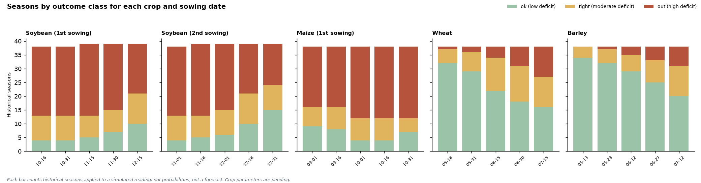
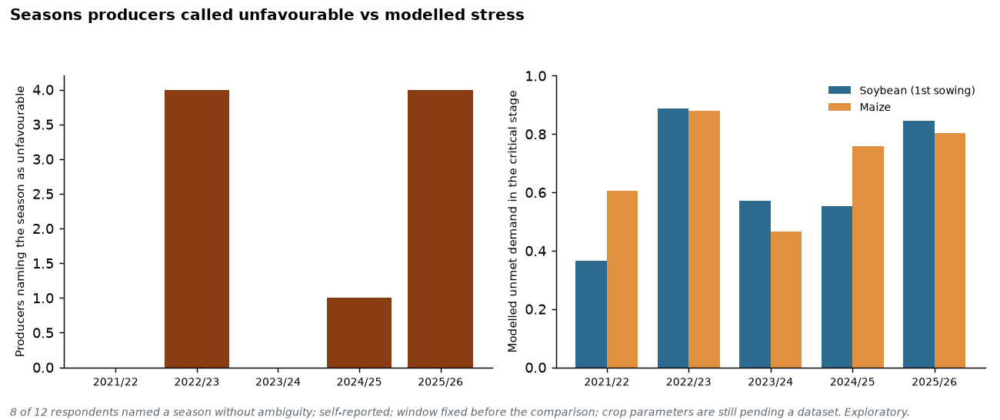
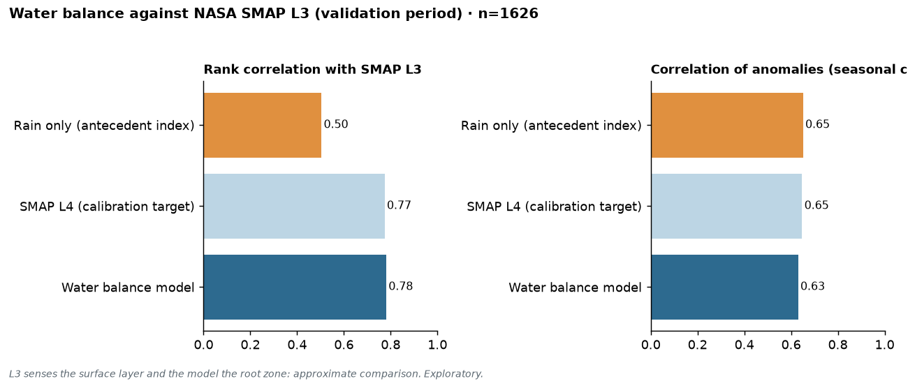
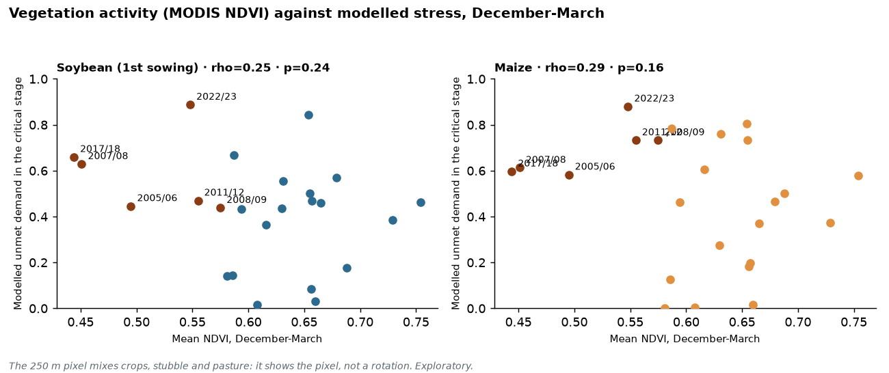
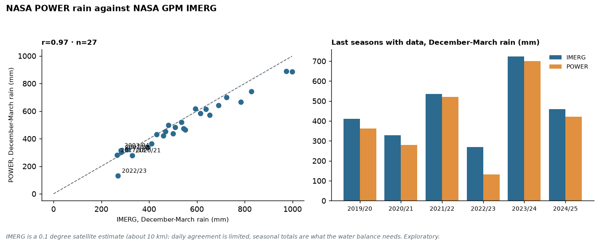
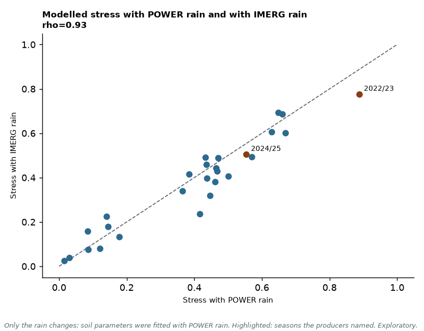

# XmartAgro experiment log

Site: `soriano` (-33.3577778, -58.078806). Generated 2026-11-14 by `xmart-analysis report`. Exploratory: nothing here validates a crop or rotation outcome.

## 1. Data architecture

Only NASA data and the team's own producer survey enter the repository.

```
NASA POWER (daily climate) --> water-balance engine --> scenarios per historical season --> frontend JSON
NASA SMAP L4 -----------------> calibration (soil parameters, fitted) ----^
validators (not model inputs): SMAP L3/L4, MODIS NDVI, GPM IMERG, producer survey
```

| file | role | source | period | rows | sha256 |
| --- | --- | --- | --- | --- | --- |
| sites/soriano/power_daily.csv | model_input | nasa_power | 1986-07-01/2026-06-30 | 14610 | 9c85022f18c4 |
| sites/soriano/imerg_daily.csv | validation | gpm_imerg | 1998-01-01/2025-09-30 | 10135 | 39c0e29c703f |
| sites/soriano/calibration.json | model_input | smap_l4 | - | - | 2ada5404aa83 |
| survey/producer_survey.csv | reference | producer_survey | - | 12 | e2671fe05883 |
| survey/survey_rotations.csv | options | producer_survey | - | 60 | 27f8c33dc5e9 |
| survey/survey_unfavorable_seasons.csv | validation | producer_survey | - | 9 | 88ef21704853 |

External files used by the runs below (not stored in the repository, identified by checksum):

| input | file | sha256 |
| --- | --- | --- |
| smap_l3 | xmartagro-punto2-smap-SPL3SMP-E-006-results.csv | 992ae2785284 |
| smap_l4 | xmartagro-punto2-smap-l4-SPL4SMGP-008-results.csv | 4cbeb19585a2 |
| modis_ndvi | xmartagro-punto2-modis-ndvi-MOD13Q1-061-results.csv | 90fdc8d0dac4 |
| imerg | imerg_daily.csv | 39c0e29c703f |

## 2. Model and calibration

Daily soil-water bucket (Hargreaves evapotranspiration from latitude and temperature range, crop coefficient by stage), calibrated by differential evolution against SMAP L4 root-zone moisture.

| parameter | value |
| --- | --- |
| theta_min | 0.1894 |
| capacity_mm | 163.4771 |
| kc | 0.9266 |
| stress_threshold | 0.6961 |
| drainage_onset_fraction | 0.9488 |
| daily_drainage | 0.2736 |

| period | days | RMSE m3/m3 | bias m3/m3 | correlation | anomaly correlation |
| --- | --- | --- | --- | --- | --- |
| calibration 2015-04-01/2020-12-31 | 2102 | 0.0236 | 0.0001 | 0.807 | 0.819 |
| validation 2021-01-01/2026-06-30 | 2007 | 0.0279 | -0.0094 | 0.833 | 0.775 |

Chosen seed: 1. the run closest to the median of the seeds within 1% of the best calibration error.

Parameters of every seed (they differ: the soil is not uniquely identified):

| seed | theta_min | capacity_mm | kc | stress_threshold | drainage_onset_fraction | daily_drainage |
| --- | --- | --- | --- | --- | --- | --- |
| 7 | 0.1894 | 163.222 | 0.9273 | 0.6953 | 0.95 | 0.2546 |
| 1 | 0.1894 | 163.4771 | 0.9266 | 0.6961 | 0.9488 | 0.2736 |
| 2 | 0.1915 | 160.8949 | 0.924 | 0.6808 | 0.9514 | 0.2937 |
| 3 | 0.1715 | 170.7161 | 0.6296 | 0.5752 | 0.4153 | 0.0078 |
| 4 | 0.1895 | 162.8404 | 0.9287 | 0.6955 | 0.9529 | 0.2824 |

Crop parameters are all `pending` (no dataset yet).

## 3. Model output for the bundled demo scenario

| option | kind | water risk | ok | tight | out |
| --- | --- | --- | --- | --- | --- |
| barley@06-10 | crop | - | - | - | - |
| survey_01 | rotation | medium | 4 | 2 | 4 |
| survey_02 | rotation | medium | 4 | 2 | 4 |
| survey_03 | rotation | low | 4 | 3 | 3 |
| survey_04 | rotation | low | 4 | 3 | 3 |
| survey_07 | rotation | medium | 4 | 2 | 4 |
| survey_08 | rotation | medium | 3 | 3 | 4 |
| survey_09 | rotation | medium | 4 | 2 | 4 |
| survey_10 | rotation | medium | 2 | 3 | 5 |
| survey_11 | rotation | medium | 4 | 2 | 4 |
| survey_12 | rotation | medium | 3 | 2 | 5 |

Risk comes from how many of the 39 historical seasons end in high deficit; the drops are counts, not probabilities.

## 4. What happens if a crop is sown on a given date

**Question.** For each crop and sowing date (the default date and four shifted by 15 and 30 days), how many of the historical seasons end in low, moderate or high deficit in the critical stage?



<details><summary>Values plotted in this figure</summary>

| crop | sowing (month-day) | ok | tight | out |
| --- | --- | --- | --- | --- |
| soybean_1st | 10-16 | 4 | 9 | 25 |
| soybean_1st | 10-31 | 4 | 9 | 25 |
| soybean_1st | 11-15 | 5 | 8 | 26 |
| soybean_1st | 11-30 | 7 | 8 | 24 |
| soybean_1st | 12-15 | 10 | 11 | 18 |
| soybean_2nd | 11-01 | 4 | 9 | 25 |
| soybean_2nd | 11-16 | 5 | 8 | 26 |
| soybean_2nd | 12-01 | 6 | 9 | 24 |
| soybean_2nd | 12-16 | 10 | 11 | 18 |
| soybean_2nd | 12-31 | 15 | 9 | 15 |
| maize | 09-01 | 9 | 7 | 22 |
| maize | 09-16 | 8 | 8 | 22 |
| maize | 10-01 | 4 | 8 | 26 |
| maize | 10-16 | 4 | 8 | 26 |
| maize | 10-31 | 7 | 5 | 26 |
| wheat | 05-16 | 32 | 5 | 1 |
| wheat | 05-31 | 29 | 7 | 2 |
| wheat | 06-15 | 22 | 12 | 4 |
| wheat | 06-30 | 18 | 13 | 7 |
| wheat | 07-15 | 16 | 11 | 11 |
| barley | 05-13 | 34 | 4 | 0 |
| barley | 05-28 | 32 | 5 | 1 |
| barley | 06-12 | 29 | 6 | 3 |
| barley | 06-27 | 25 | 8 | 5 |
| barley | 07-12 | 20 | 11 | 7 |

</details>

**Reading.** Each bar applies every complete historical season to a simulated reading at the chosen sowing date. soybean_1st: default date 11-15, median stress 0.27-0.436 across the dates. soybean_2nd: default date 12-01, median stress 0.169-0.428 across the dates. maize: default date 10-01, median stress 0.352-0.437 across the dates. wheat: default date 06-15, median stress 0.0-0.126 across the dates. barley: default date 06-12, median stress 0.0-0.092 across the dates.

Median stress and water at sowing per run (every run carries the fixed-cycle warning; `sowing_far_from_reading` marks a sowing far from the reading date):

| crop | sowing | shift days | median stress | median water at sowing mm | warnings |
| --- | --- | --- | --- | --- | --- |
| soybean_1st | 10-16 | -30 | 0.412 | 103.2 | cycle_length_fixed, sowing_far_from_reading |
| soybean_1st | 10-31 | -15 | 0.407 | 96.8 | cycle_length_fixed, sowing_far_from_reading |
| soybean_1st | 11-15 | 0 | 0.436 | 86.7 | cycle_length_fixed |
| soybean_1st | 11-30 | 15 | 0.372 | 73.9 | cycle_length_fixed |
| soybean_1st | 12-15 | 30 | 0.27 | 68.9 | cycle_length_fixed |
| soybean_2nd | 11-01 | -30 | 0.414 | 99.9 | cycle_length_fixed, sowing_far_from_reading |
| soybean_2nd | 11-16 | -15 | 0.428 | 83.9 | cycle_length_fixed |
| soybean_2nd | 12-01 | 0 | 0.371 | 72.9 | cycle_length_fixed |
| soybean_2nd | 12-16 | 15 | 0.262 | 65.9 | cycle_length_fixed |
| soybean_2nd | 12-31 | 30 | 0.169 | 72.2 | cycle_length_fixed |
| maize | 09-01 | -30 | 0.352 | 125.6 | cycle_length_fixed, sowing_far_from_reading |
| maize | 09-16 | -15 | 0.385 | 124.4 | cycle_length_fixed, sowing_far_from_reading |
| maize | 10-01 | 0 | 0.429 | 110.5 | cycle_length_fixed, sowing_far_from_reading |
| maize | 10-16 | 15 | 0.437 | 103.2 | cycle_length_fixed, sowing_far_from_reading |
| maize | 10-31 | 30 | 0.419 | 96.8 | cycle_length_fixed, sowing_far_from_reading |
| wheat | 05-16 | -30 | 0.0 | 124.5 | cycle_length_fixed, sowing_far_from_reading |
| wheat | 05-31 | -15 | 0.01 | 137.1 | cycle_length_fixed, sowing_far_from_reading |
| wheat | 06-15 | 0 | 0.066 | 133.8 | cycle_length_fixed, sowing_far_from_reading |
| wheat | 06-30 | 15 | 0.104 | 136.8 | cycle_length_fixed, sowing_far_from_reading |
| wheat | 07-15 | 30 | 0.126 | 141.4 | cycle_length_fixed, sowing_far_from_reading |
| barley | 05-13 | -30 | 0.0 | 126.7 | cycle_length_fixed, sowing_far_from_reading |
| barley | 05-28 | -15 | 0.0 | 139.2 | cycle_length_fixed, sowing_far_from_reading |
| barley | 06-12 | 0 | 0.015 | 135.6 | cycle_length_fixed, sowing_far_from_reading |
| barley | 06-27 | 15 | 0.07 | 135.8 | cycle_length_fixed, sowing_far_from_reading |
| barley | 07-12 | 30 | 0.092 | 138.0 | cycle_length_fixed, sowing_far_from_reading |

<details><summary>Season by season: soybean_1st sown 11-15</summary>

| season | water at sowing mm | stress | deficit days | class |
| --- | --- | --- | --- | --- |
| 1987/88 | 102.9 | 0.178 | 21 | tight |
| 1988/89 | 86.6 | 0.676 | 57 | out |
| 1989/90 | 86.4 | 0.255 | 22 | tight |
| 1990/91 | 116.9 | 0.325 | 35 | out |
| 1991/92 | 87.2 | 0.274 | 40 | tight |
| 1992/93 | 122.3 | 0.185 | 26 | tight |
| 1993/94 | 89.7 | 0.505 | 55 | out |
| 1994/95 | 89.2 | 0.631 | 60 | out |
| 1995/96 | 86.7 | 0.576 | 60 | out |
| 1996/97 | 86.4 | 0.405 | 54 | out |
| 1997/98 | 86.4 | 0.049 | 7 | ok |
| 1998/99 | 88.7 | 0.121 | 18 | tight |
| 1999/00 | 85.8 | 0.65 | 58 | out |
| 2000/01 | 88.0 | 0.088 | 15 | ok |
| 2001/02 | 87.5 | 0.419 | 49 | out |
| 2002/03 | 86.1 | 0.145 | 18 | tight |
| 2003/04 | 86.5 | 0.433 | 44 | out |
| 2004/05 | 95.2 | 0.459 | 43 | out |
| 2005/06 | 105.4 | 0.441 | 47 | out |
| 2006/07 | 85.7 | 0.436 | 43 | out |
| 2007/08 | 88.4 | 0.629 | 57 | out |
| 2008/09 | 85.4 | 0.44 | 50 | out |
| 2009/10 | 89.9 | 0.03 | 6 | ok |
| 2010/11 | 86.8 | 0.501 | 49 | out |
| 2011/12 | 86.3 | 0.472 | 34 | out |
| 2012/13 | 87.1 | 0.468 | 48 | out |
| 2013/14 | 85.8 | 0.18 | 19 | tight |
| 2014/15 | 86.5 | 0.14 | 19 | tight |
| 2015/16 | 86.2 | 0.391 | 33 | out |
| 2016/17 | 86.1 | 0.091 | 14 | ok |
| 2017/18 | 86.0 | 0.662 | 60 | out |
| 2018/19 | 87.1 | 0.015 | 2 | ok |
| 2019/20 | 86.7 | 0.466 | 53 | out |
| 2020/21 | 87.0 | 0.669 | 60 | out |
| 2021/22 | 119.7 | 0.343 | 37 | out |
| 2022/23 | 93.0 | 0.888 | 60 | out |
| 2023/24 | 86.3 | 0.576 | 58 | out |
| 2024/25 | 85.5 | 0.557 | 48 | out |
| 2025/26 | 85.7 | 0.847 | 60 | out |

</details>

Sensitivity to the sensor reading (soybean_1st, default sowing date; the reading is simulated):

| volumetric moisture | ok | tight | out |
| --- | --- | --- | --- |
| 0.15 | 3 | 8 | 28 |
| 0.28 | 5 | 8 | 26 |
| 0.4 | 5 | 8 | 26 |

counts are historical seasons applied to the reading, not probabilities; the reading is simulated and crop parameters are pending.

## 5. Producers' unfavourable seasons vs modelled stress

**Question.** Do the seasons the producers called unfavourable match the model's critical-stage stress?



<details><summary>Values plotted in this figure</summary>

| season | producers naming it | soybean_1st stress | maize stress |
| --- | --- | --- | --- |
| 2021/22 | 0 | 0.365 | 0.606 |
| 2022/23 | 4 | 0.888 | 0.88 |
| 2023/24 | 0 | 0.57 | 0.467 |
| 2024/25 | 1 | 0.554 | 0.759 |
| 2025/26 | 4 | 0.845 | 0.804 |

</details>

**Reading.** The two most stressed seasons are 2022/23, 2025/26 for soybean and 2022/23, 2025/26 for maize; the most named by producers are 2022/23, 2025/26. Agreement: True / True. 8 of 12 respondents answered unambiguously.

## 6. Modelled soil water vs SMAP

**Question.** Does the model follow independent soil-moisture data in years it was not fitted on?



<details><summary>Values plotted in this figure</summary>

| predictor | rank correlation | anomaly correlation |
| --- | --- | --- |
| model | 0.781 | 0.63 |
| smap_l4 | 0.774 | 0.647 |
| rain_index | 0.504 | 0.651 |

</details>

**Reading.** Validation period rank correlation / anomaly correlation: model 0.781 / 0.63, smap_l4 0.774 / 0.647, rain_index 0.504 / 0.651 (n=1626 days). L3 senses the surface layer; the model represents the root zone, so the comparison is approximate

## 7. Modelled stress vs MODIS NDVI

**Question.** Do seasons with a greener pixel in Dec-Mar have lower modelled stress?



<details><summary>Values plotted in this figure</summary>

| season | NDVI Dec-Mar | soybean_1st stress | maize stress |
| --- | --- | --- | --- |
| 2002/03 | 0.586 | 0.145 | 0.126 |
| 2003/04 | 0.594 | 0.433 | 0.464 |
| 2004/05 | 0.754 | 0.464 | 0.578 |
| 2005/06 | 0.495 | 0.446 | 0.583 |
| 2006/07 | 0.63 | 0.436 | 0.274 |
| 2007/08 | 0.451 | 0.629 | 0.613 |
| 2008/09 | 0.575 | 0.438 | 0.733 |
| 2009/10 | 0.66 | 0.03 | 0.016 |
| 2010/11 | 0.655 | 0.5 | 0.735 |
| 2011/12 | 0.555 | 0.47 | 0.733 |
| 2012/13 | 0.657 | 0.468 | 0.199 |
| 2013/14 | 0.688 | 0.178 | 0.502 |
| 2014/15 | 0.581 | 0.14 | 0.0 |
| 2015/16 | 0.729 | 0.384 | 0.372 |
| 2016/17 | 0.656 | 0.085 | 0.184 |
| 2017/18 | 0.444 | 0.66 | 0.597 |
| 2018/19 | 0.608 | 0.015 | 0.004 |
| 2019/20 | 0.665 | 0.461 | 0.37 |
| 2020/21 | 0.587 | 0.669 | 0.785 |
| 2021/22 | 0.616 | 0.365 | 0.606 |
| 2022/23 | 0.548 | 0.888 | 0.88 |
| 2023/24 | 0.679 | 0.57 | 0.467 |
| 2024/25 | 0.631 | 0.554 | 0.759 |
| 2025/26 | 0.654 | 0.845 | 0.804 |

</details>

**Reading.** Spearman of NDVI against minus stress: soybean_1st 0.253 (p=0.2356), maize 0.291 (p=0.1645). 3 of the 6 most stressed seasons are among the lowest-NDVI (chance: 1.5). Weak evidence: the pixel mixes crops, stubble and pasture.

## 8. POWER rain vs GPM IMERG rain

**Question.** How well do the two NASA rain estimates agree at the field?



<details><summary>Values plotted in this figure</summary>

| season | IMERG Dec-Mar mm | POWER Dec-Mar mm |
| --- | --- | --- |
| 1998/99 | 690 | 641 |
| 1999/00 | 309 | 320 |
| 2000/01 | 593 | 618 |
| 2001/02 | 653 | 572 |
| 2002/03 | 615 | 584 |
| 2003/04 | 281 | 315 |
| 2004/05 | 431 | 432 |
| 2005/06 | 500 | 437 |
| 2006/07 | 998 | 887 |
| 2007/08 | 283 | 302 |
| 2008/09 | 468 | 451 |
| 2009/10 | 974 | 890 |
| 2010/11 | 394 | 336 |
| 2011/12 | 552 | 466 |
| 2012/13 | 545 | 475 |
| 2013/14 | 783 | 665 |
| 2014/15 | 481 | 498 |
| 2015/16 | 509 | 483 |
| 2016/17 | 638 | 615 |
| 2017/18 | 265 | 281 |
| 2018/19 | 827 | 742 |
| 2019/20 | 410 | 363 |
| 2020/21 | 329 | 279 |
| 2021/22 | 535 | 520 |
| 2022/23 | 270 | 131 |
| 2023/24 | 723 | 701 |
| 2024/25 | 460 | 421 |

</details>

**Reading.** Daily r 0.764, monthly r 0.955, Dec-Mar by season r 0.975; annual mean POWER 1159 mm, IMERG 1289 mm (1998-01-01 to 2025-09-30). Driest seasons by IMERG ['2017/18', '2022/23', '2003/04', '2007/08'], by POWER ['2022/23', '2020/21', '2017/18', '2007/08'].

## 9. Model run with POWER rain and with IMERG rain

**Question.** Does the result change if the model uses IMERG rain? Only the rain changes; soil parameters stay the POWER-fitted ones.



<details><summary>Values plotted in this figure</summary>

| season | stress with POWER rain | stress with IMERG rain |
| --- | --- | --- |
| 1998/99 | 0.121 | 0.081 |
| 1999/00 | 0.649 | 0.693 |
| 2000/01 | 0.086 | 0.076 |
| 2001/02 | 0.416 | 0.236 |
| 2002/03 | 0.145 | 0.178 |
| 2003/04 | 0.433 | 0.492 |
| 2004/05 | 0.464 | 0.442 |
| 2005/06 | 0.446 | 0.319 |
| 2006/07 | 0.436 | 0.459 |
| 2007/08 | 0.629 | 0.606 |
| 2008/09 | 0.438 | 0.397 |
| 2009/10 | 0.03 | 0.04 |
| 2010/11 | 0.5 | 0.407 |
| 2011/12 | 0.47 | 0.489 |
| 2012/13 | 0.468 | 0.429 |
| 2013/14 | 0.178 | 0.133 |
| 2014/15 | 0.14 | 0.226 |
| 2015/16 | 0.384 | 0.415 |
| 2016/17 | 0.085 | 0.159 |
| 2017/18 | 0.66 | 0.686 |
| 2018/19 | 0.015 | 0.026 |
| 2019/20 | 0.461 | 0.381 |
| 2020/21 | 0.669 | 0.601 |
| 2021/22 | 0.365 | 0.34 |
| 2022/23 | 0.888 | 0.775 |
| 2023/24 | 0.57 | 0.493 |
| 2024/25 | 0.554 | 0.504 |

</details>

**Reading.** soybean_1st: 27 seasons, rank agreement 0.926, mean absolute stress difference 0.054, high-deficit seasons 19 (POWER) vs 18 (IMERG). maize: 27 seasons, rank agreement 0.965, mean absolute stress difference 0.039, high-deficit seasons 18 (POWER) vs 18 (IMERG).

Share of seasons with high deficit per rotation:

| rotation | POWER rain | IMERG rain |
| --- | --- | --- |
| survey_01 | 0.407 | 0.349 |
| survey_02 | 0.407 | 0.349 |
| survey_03 | 0.361 | 0.306 |
| survey_04 | 0.361 | 0.278 |
| survey_07 | 0.377 | 0.327 |
| survey_08 | 0.444 | 0.393 |
| survey_09 | 0.449 | 0.403 |
| survey_10 | 0.528 | 0.472 |
| survey_11 | 0.444 | 0.383 |
| survey_12 | 0.5 | 0.454 |

## 10. Integrity checks

| check | result |
| --- | --- |
| provenance and dataset manifest | consistent |
| values plotted are the values in the tables above | enforced by tests (`tests/test_report.py`) |
| files used are at the site's point | enforced when loading (`file_not_at_site`) |

## Not validated

- Crop parameters (`pending`) and therefore per-crop and per-rotation risk.
- Soil state and effect (no diagnosis exists); the sensor reading in the demo is simulated.
- Which rain source is closer to the truth (no gauge data).

